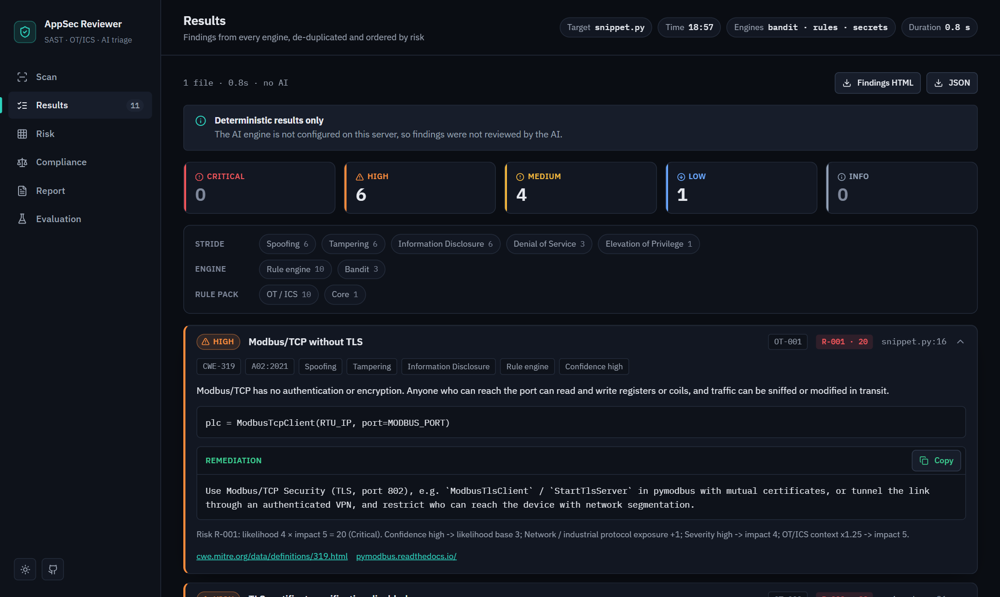
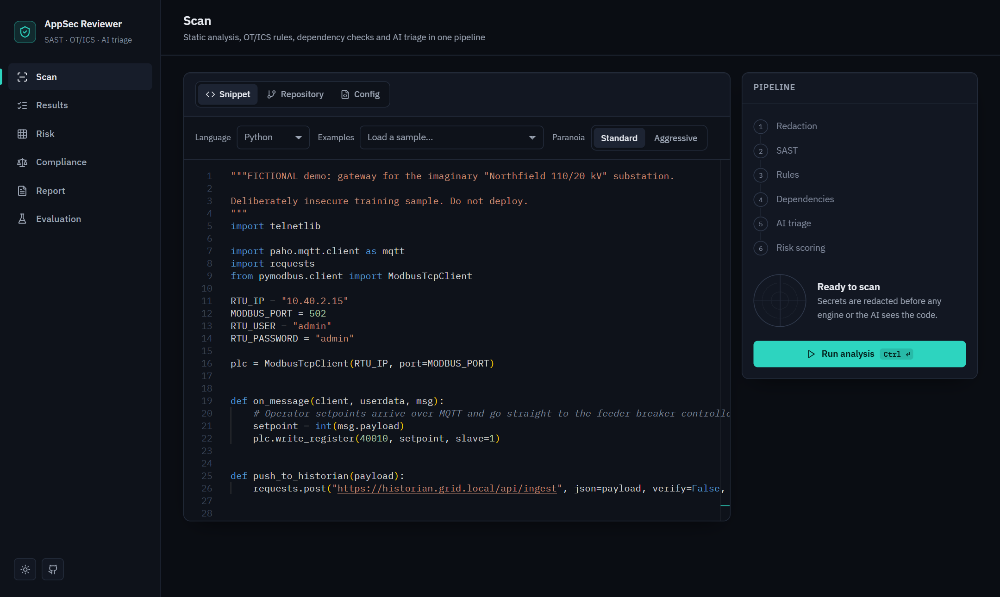
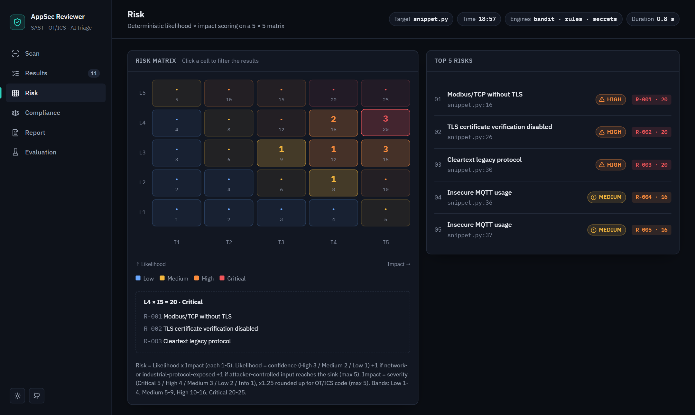
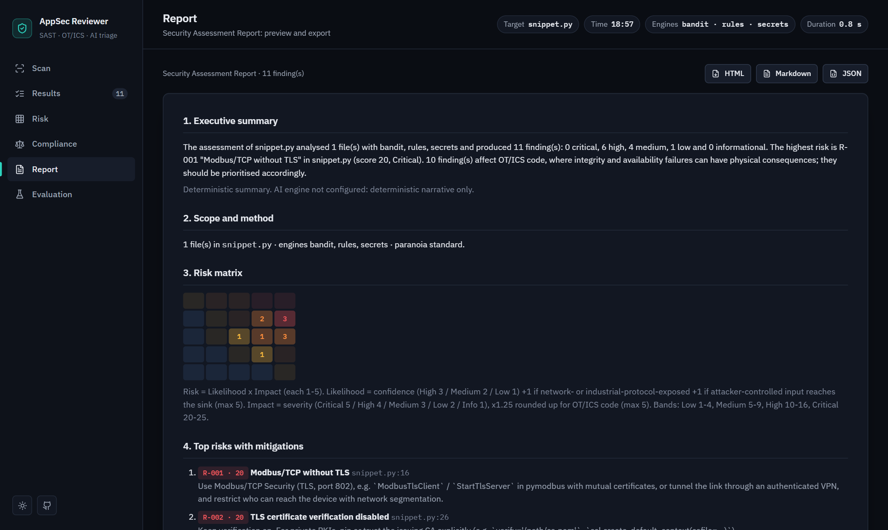
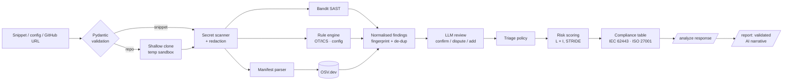

<div align="center">

# 🛡️ AI AppSec Code Reviewer

**Security assessment for application, container and industrial (OT / smart-grid) code: static analysis, OT/ICS rule packs, configuration and dependency checks, AI triage, deterministic risk scoring and an exportable Security Assessment Report.**

[](https://github.com/olegicks/ai-appsec-reviewer/actions/workflows/ci.yml)


[**Live Demo**](https://ai-appsec-reviewer-7qgg.vercel.app/) · [**API**](https://ai-appsec-reviewer.onrender.com/health) · [Architecture](#-architecture) · [OT rules](#-ot--smart-grid-security) · [Evaluation](#-evaluation) · [Local setup](#-local-setup)

</div>



Paste a snippet, a Dockerfile or Kubernetes manifest, or point the tool at a public GitHub repository. **Deterministic engines decide** what is found and how risky it is: Bandit, a secret scanner, OT/ICS and configuration rule packs, and an OSV dependency check. **The LLM explains**: it confirms or disputes findings, adds what the rules missed and writes the report prose, but it never sets a risk score or a compliance mapping. Secrets are redacted before anything else runs, and every model output is validated against a strict schema.

> [!NOTE]
> The backend runs on Render's free tier and sleeps when idle. The page pings it on load, but the first scan can still take about 30 seconds.

---

## ✨ Features

| | |
|---|---|
| 🏭 **OT / ICS awareness** | 10 rules for Modbus/TCP, IEC 60870-5-104, DNP3, OPC UA, MQTT, Telnet/FTP, device credentials, TLS verification and field-device timeouts |
| 🐳 **Config security** | Dockerfile, docker-compose and Kubernetes checks (root, privileged, host namespaces, exposed databases, unpinned images, secrets in `ENV`) |
| 📦 **Dependency check** | Direct dependencies from `requirements*.txt`, `pyproject.toml` and `package.json`, batch-checked against OSV.dev with graceful degradation |
| 🧪 **SAST + secrets** | Bandit for Python; secret scanner for AWS, GitHub, OpenAI, Google and Slack keys, JWTs, Bearer tokens, private keys and passwords |
| 🤖 **AI triage** | Reviews every deterministic finding (confirmed / disputed), adds missed issues, prompt-injection hardened, schema-validated |
| 🎯 **Risk scoring** | Likelihood × impact on a 5 × 5 matrix with an OT/ICS uplift; STRIDE categories for every finding |
| 📋 **Compliance** | Indicative mapping to IEC 62443-3-3 foundational requirements and ISO/IEC 27001:2022 Annex A controls |
| 📄 **Assessment report** | Executive summary, risk matrix, top risks with mitigations, STRIDE, compliance, limitations and appendix, exported as HTML, Markdown or JSON |
| 📏 **Measured quality** | Labelled dataset and evaluation harness with precision / recall / F1 per engine, gated in CI |

## 🖥️ Screenshots

| Scan | Risk heatmap |
|---|---|
|  |  |
| **Results** | **Report** |
|  |  |

Screenshots were taken with the AI engine disabled, so they show deterministic results only.

## 🏗️ Architecture



- **Normalised findings.** Every engine produces the same `Finding` model with a stable fingerprint (rule id + file + line + snippet hash). Findings from different engines on the same line and CWE are merged and keep the list of engines.
- **Triage policy.** Rule-engine findings are never dropped by the AI, only marked *disputed*. Bandit and secret signals the AI rejects are dropped in standard mode and kept as disputed in aggressive mode. For findings only the AI reports, the API keeps the model's severity label, while risk scoring uses a static CWE baseline.
- **No AI configured?** The API still returns the full deterministic result (`meta.ai_status: "not_configured"`) and a deterministic report narrative.

```text
backend/
├── main.py                  # routes: /analyze, /report, /health
├── reviewer/
│   ├── pipeline.py          # discovery → redaction → engines → LLM context
│   ├── findings.py          # Finding model, fingerprints, de-duplication
│   ├── rules/               # rule engine: base, python_ast, text, config, deps, ot_ics
│   ├── osv.py               # OSV.dev batch client
│   ├── triage.py            # merges AI verdicts with deterministic findings
│   ├── risk.py              # likelihood × impact scoring
│   ├── compliance.py        # curated IEC 62443 / ISO 27001 table
│   ├── taxonomy.py          # CWE → STRIDE / OWASP / baseline severity
│   ├── report.py            # report narrative + validation
│   └── llm.py               # prompt, OpenAI call, error mapping
eval/                        # dataset.yaml, samples, harness, recordings
frontend/src/                # React console: Scan, Results, Risk, Compliance, Report, Evaluation
```

## 🏭 OT / smart-grid security

| ID | Rule | CWE |
|---|---|---|
| OT-001 | Modbus/TCP client or server without TLS | CWE-319 |
| OT-002 | Register / coil writes with values that are not validated or bounded | CWE-20 |
| OT-003 | IEC 60870-5-104 / DNP3 without TLS or secure authentication (heuristic) | CWE-319 |
| OT-004 | OPC UA with `SecurityPolicy None`, `MessageSecurityMode None` or no certificate validation | CWE-319 |
| OT-005 | MQTT without TLS or credentials; `#` wildcard subscriptions | CWE-319 |
| OT-006 | Cleartext legacy protocols: Telnet, FTP, plain HTTP to private IPs | CWE-319 |
| OT-007 | Hardcoded device IPs on industrial ports (502, 2404, 20000, 102, 4840, 1883) | CWE-1051 |
| OT-008 | Default or empty device credentials (`admin/admin`, `root`, `""`) | CWE-1392 |
| OT-009 | Disabled certificate verification (`verify=False`, `CERT_NONE`, `rejectUnauthorized: false`, …) | CWE-295 |
| OT-010 | Field-device connections without timeouts | CWE-1088 |

Python is analysed on the AST, so aliases and module-level constants are resolved; other languages use text rules. The **Smart grid** sample in the UI is a fictional, deliberately insecure substation gateway that triggers most of the pack. Configuration rules (`DOCKER-001…005`, `COMPOSE-001…005`, `K8S-001…006`) and the dependency rule `DEP-001` follow the same model.

## 🎯 Risk formula

**Risk = Likelihood × Impact**, each from 1 to 5. **Likelihood** starts at the finding's confidence (High 3, Medium 2, Low 1). It gets +1 when the code is network-facing or uses an industrial protocol, and +1 when attacker-controlled input reaches the sink, up to 5. **Impact** comes from severity (Critical 5, High 4, Medium 3, Low 2, Info 1). For OT/ICS code it is multiplied by 1.25, rounded up and capped at 5, because integrity and availability failures there can have physical consequences. **Bands:** Low 1–4, Medium 5–9, High 10–16, Critical 20–25. Every finding carries the factors that produced its score.

## 📋 Compliance mapping

> [!IMPORTANT]
> **Indicative mapping, not a certification or audit result.**

The mapping comes from a static table in [`compliance.py`](backend/reviewer/compliance.py): first by rule, then by CWE, then by STRIDE category. It is never produced by the LLM. It covers IEC 62443-3-3 FR1–FR7 and these ISO/IEC 27001:2022 Annex A controls: A.8.2, A.8.3, A.8.5, A.8.6, A.8.8, A.8.9, A.8.12, A.8.15, A.8.16, A.8.20, A.8.22, A.8.24 and A.8.28.

## 📏 Evaluation

51 labelled samples (26 vulnerable, 25 safe) across OT/ICS, configuration, classic AppSec and secrets. Full method and per-category tables: [docs/EVALUATION.md](docs/EVALUATION.md).

| Engine | Precision | Recall | F1 | FP rate (safe) |
|---|---:|---:|---:|---:|
| SAST only (Bandit) | 0.53 | 0.16 | 0.24 | 0.12 |
| Rule engine (OT/ICS + config + secrets) | 1.00 | 0.80 | 0.89 | 0.00 |
| LLM only | not measured yet | | | |
| Hybrid pipeline | not measured yet | | | |

How to read this:
- **The rule samples were written together with the rules.** These numbers show that the rules behave as specified. They are not a claim about how the rules perform on unseen code.
- **The rule engine finds no classic AppSec bugs, by design.** Its recall on those samples is 0.00; SQL injection, XSS and memory-safety bugs are left to Bandit and the LLM.
- **LLM numbers come only from recorded responses.** No responses have been recorded yet, so the LLM rows are empty rather than estimated. To record them, run `python -m eval.run --engine all --live --record --write` once; this calls the real API.

CI re-runs the offline evaluation on every push and fails if recall of the OT rule pack drops below 0.90 or its false-positive rate on safe samples rises above 0.10.

## 🔌 API

| Method | Endpoint | Description |
|---|---|---|
| `GET` | `/health` | Status, version, whether AI is configured, model name |
| `POST` | `/analyze` | Run the pipeline. Rate limit: 5 requests/min per IP |
| `POST` | `/report` | Executive summary and mitigations for the report. Body: `{target, result}`. Uses the AI when configured, otherwise a deterministic narrative |

`/analyze` accepts `mode` (`snippet` or `repo`), `language` (`python`, `javascript`, `typescript`, `java`, `cpp`, `go` or `config`), `code` or `repo_url`, and `paranoia_level`. All v1 response fields are unchanged. These v2 fields are additive:

| Where | Field | Meaning |
|---|---|---|
| each finding | `id`, `rule_id`, `title`, `category`, `pack` | Stable fingerprint, rule metadata |
| each finding | `engine`, `engines`, `ai_verdict`, `ai_note` | Which engines reported it and the AI's verdict |
| each finding | `stride`, `risk {id, likelihood, impact, score, band, factors}` | Threat class and deterministic risk |
| each finding | `compliance {iec62443, iso27001}`, `dependency`, `excerpt`, `line_number`, `references` | Mapping, OSV details, redacted excerpt |
| top level | `risk_matrix`, `top_risks`, `stride_summary`, `compliance_summary`, `dependencies` | Aggregates for the risk, compliance and report views |
| `meta` | `engines`, `ai_status`, `rule_findings`, `config_files` | Scan metadata |

Errors return `{"detail": "...", "code": "..."}`. AI problems use explicit codes: `ai_not_configured`, `model_unavailable`, `model_access_denied`, `model_parameter_unsupported`, `ai_auth_failed`, `ai_quota_exceeded`, `ai_rate_limited` and `ai_unreachable`.

## 🚀 Local setup

**Prerequisites:** Python 3.11+, Node.js 20+, Git. An OpenAI API key is optional; without it you get deterministic results.

```powershell
git clone https://github.com/olegicks/ai-appsec-reviewer.git
cd ai-appsec-reviewer
```

### Backend

```powershell
cd backend
python -m venv venv
venv\Scripts\activate
pip install -r requirements-dev.txt
copy .env.example .env      # set OPENAI_API_KEY and OPENAI_MODEL
uvicorn main:app --reload
```

| Variable | Default | Description |
|---|---|---|
| `OPENAI_API_KEY` / `OPENAI_MODEL` | – | Enable AI triage and the AI report narrative. There is no default model; see the [deprecations page](https://developers.openai.com/api/docs/deprecations) |
| `OPENAI_TEMPERATURE` | unset | Optional; leave unset for models that reject it |
| `FRONTEND_URL` | `http://localhost:5173` | Allowed CORS origins, comma-separated |
| `RATE_LIMIT` | `5/minute` | Per-IP limit for `/analyze` and `/report` |
| `MAX_REPO_FILES` / `MAX_CONFIG_FILES` | `20` / `10` | Repository caps for source and config files |
| `OSV_ENABLED` | `true` | Set to `false` to disable the dependency check |

### Frontend

```powershell
cd frontend
npm install
Set-Content .env.local "VITE_API_URL=http://localhost:8000"
npm run dev
```

## 🧪 Tests and evaluation

```powershell
# Backend: rule engine, OT and config rules, OSV (mocked), triage, risk, compliance, report, API
cd backend; venv\Scripts\python -m pytest

# Offline evaluation (free, no network)
cd ..; backend\venv\Scripts\python -m eval.run --engine all
backend\venv\Scripts\python -m eval.run --engine rules --check

# Frontend: filters, heatmap, report export, theme, reduced motion, API client
cd frontend; npm test; npm run lint; npm run build
```

No test or CI job calls OpenAI or OSV: both are mocked, and a test fixture blocks unmocked OSV requests.

## 🛠️ Tech stack

- **Backend:** Python, FastAPI, Pydantic v2, Bandit, PyYAML, httpx, SlowAPI, OpenAI SDK
- **Frontend:** React 19, Vite, Monaco Editor, lucide-react, IBM Plex, pure-CSS motion that respects `prefers-reduced-motion`
- **Quality:** pytest, Vitest, Testing Library, offline evaluation harness, GitHub Actions

## ⚠️ Disclaimer

This tool supports security reviews; it does not replace them or a formal IEC 62443 / ISO/IEC 27001 assessment. Findings can be incomplete or wrong. Only scan code you are allowed to analyse.
