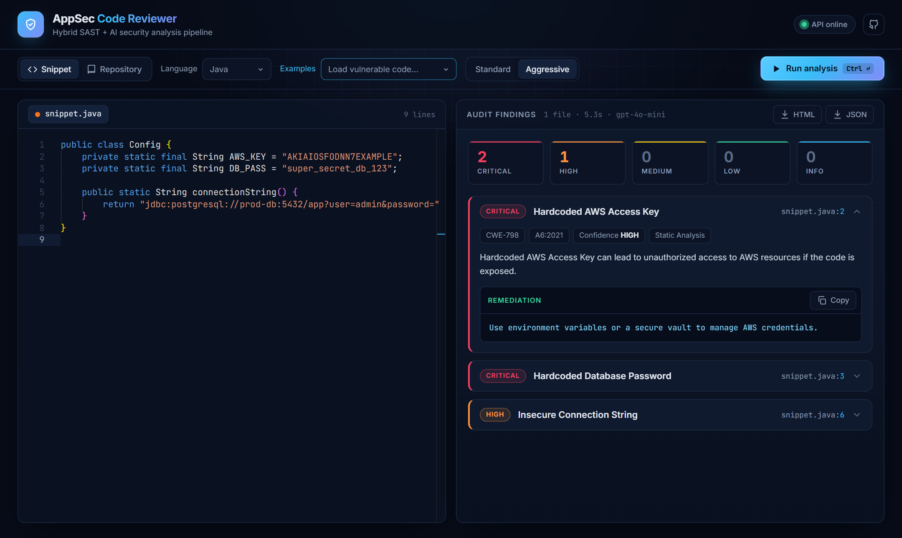
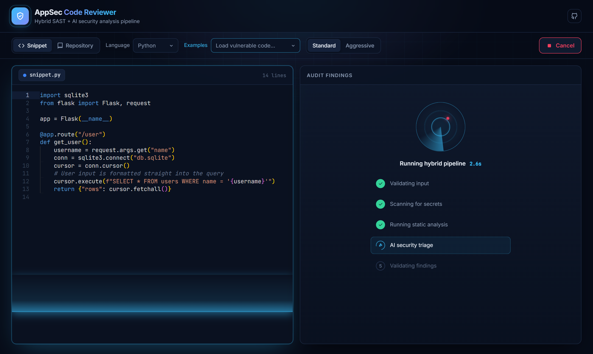
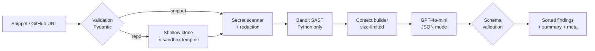

<div align="center">

# 🛡️ AI AppSec Code Reviewer

**A hybrid Application Security pipeline that combines static analysis (SAST), secret scanning, and AI triage to find vulnerabilities in code snippets and public GitHub repositories.**

[](https://github.com/olegicks/ai-appsec-reviewer/actions/workflows/ci.yml)


[**Live Demo**](https://ai-appsec-reviewer-7qgg.vercel.app/) · [**API**](https://ai-appsec-reviewer.onrender.com/health) · [Architecture](#-how-the-pipeline-works) · [Local Setup](#-local-setup)

</div>



> [!NOTE]
> The backend runs on Render's free tier and sleeps when idle. The app pings it on page load so it starts waking up early, but the first scan can still take about 30 seconds.

---

## ✨ Features

| | |
|---|---|
| 🔍 **Two scan modes** | Paste a snippet (Python, JS, TS, Java, C++, Go) or scan a whole public GitHub repo |
| 🧪 **Real SAST** | Python files go through **Bandit**; its findings are passed to the AI for validation |
| 🔑 **Secret scanner** | Detects AWS, GitHub, OpenAI, Google and Slack keys, JWTs, Bearer tokens, private keys and hardcoded passwords |
| 🙈 **Redaction before AI** | Secrets are replaced with `[REDACTED]` before code reaches Bandit or the LLM |
| 🤖 **AI triage** | GPT removes false positives and maps every finding to **CWE** and **OWASP Top 10** |
| 🧱 **Prompt-injection hardened** | Source code is treated strictly as untrusted data |
| 🎚️ **Paranoia levels** | *Standard* reports only exploitable issues; *Aggressive* also flags best-practice violations |
| 📊 **Interactive results** | Severity counters work as filters; cards collapse; remediation copies in one click |
| 📄 **Report export** | Download a standalone HTML report (all AI output escaped) or raw JSON |
| 🚦 **Hardened API** | Rate limiting, strict CORS, input validation, size and time limits, security headers |

## 🎬 Scan in progress



While the pipeline runs, a scanning beam moves over the editor and a radar animation shows each pipeline stage. You can cancel a scan at any time and start the next one with <kbd>Ctrl</kbd> + <kbd>Enter</kbd>.

## ⚙️ How the pipeline works



1. **Input validation**: Pydantic enforces the scan mode, language, payload size, and a strict `https://github.com/owner/repo` URL pattern.
2. **Safe discovery**: repositories are shallow-cloned (`--depth 1`, no prompts, 15 s timeout) into a temp dir. Vendored folders (`node_modules`, `vendor`, `dist`, …) are skipped. Limits: 20 files, 30 KB per file, 60K characters of context.
3. **Secret scanning and redaction**: values are redacted on the exact line where they are found, so downstream tools never see real credentials.
4. **Language-aware SAST**: Python goes through Bandit. Temp paths are rewritten to repo-relative paths so server paths don't leak.
5. **AI analysis**: the model reviews the code independently, confirms or rejects SAST and secret findings, and rates severity and confidence.
6. **Structured output**: the response is validated against a strict schema. Severity case is normalised, results are sorted from critical to info, and malformed AI output becomes a clean `502`.

## 🗂️ Project structure

```text
ai-appsec-reviewer/
├── backend/
│   ├── main.py                 # FastAPI app: routes, rate limiting, CORS, error handling
│   ├── reviewer/
│   │   ├── config.py           # Env-driven settings and scan limits
│   │   ├── schemas.py          # Request / finding / response models
│   │   ├── secrets.py          # Secret detection + redaction
│   │   ├── sast.py             # Bandit integration
│   │   ├── pipeline.py         # Repo cloning, file discovery, context building
│   │   └── llm.py              # System prompt, OpenAI call, output validation
│   ├── tests/                  # pytest suite (60 tests, AI mocked)
│   └── requirements*.txt
├── frontend/
│   ├── src/
│   │   ├── App.jsx             # State, scan orchestration, shortcuts, export
│   │   ├── components/         # Header, Toolbar, ScanProgress, ResultsPanel, VulnCard…
│   │   ├── lib/                # API client, severity helpers, HTML report builder
│   │   └── data/examples.js    # Vulnerable code samples
│   └── vite.config.js          # Vite + Vitest config
├── docs/screenshots/
└── .github/workflows/ci.yml    # Lint, test and build on every push
```

## 🔌 API

| Method | Endpoint | Description |
|---|---|---|
| `GET` | `/health` | Service status, version and whether the AI engine is configured |
| `POST` | `/analyze` | Run the pipeline (rate limit: 5 requests/min per IP) |

<details>
<summary>Example request and response</summary>

```bash
curl -X POST http://localhost:8000/analyze \
  -H "Content-Type: application/json" \
  -d '{"mode":"snippet","language":"python","paranoia_level":"standard","code":"import os\nos.system(\"ping \" + host)"}'
```

```json
{
  "vulnerabilities": [
    {
      "file": "snippet.py",
      "line": "Line 2",
      "vulnerability": "OS Command Injection",
      "severity": "HIGH",
      "confidence": "HIGH",
      "cwe": "CWE-78",
      "owasp": "A03:2021",
      "source": "Bandit / AI Analysis",
      "risk_explanation": "User-controlled input is concatenated into a shell command…",
      "secure_code_snippet": "subprocess.run([\"ping\", \"-c\", \"1\", host], check=True)"
    }
  ],
  "summary": { "CRITICAL": 0, "HIGH": 1, "MEDIUM": 0, "LOW": 0, "INFO": 0, "TOTAL": 1 },
  "meta": { "mode": "snippet", "model": "gpt-4o-mini", "paranoia_level": "standard",
            "files_scanned": 1, "secrets_found": 0, "sast_findings": 1, "truncated": false, "duration_ms": 4210 }
}
```

</details>

## 🚀 Local setup

**Prerequisites:** Python 3.10+, Node.js 20+, Git, and an OpenAI API key.

```bash
git clone https://github.com/olegicks/ai-appsec-reviewer.git
cd ai-appsec-reviewer
```

### Backend

```bash
cd backend
python -m venv venv
source venv/bin/activate        # Windows: venv\Scripts\activate
pip install -r requirements.txt
cp .env.example .env            # then put your OPENAI_API_KEY in .env
uvicorn main:app --reload
```

| Variable | Default | Description |
|---|---|---|
| `OPENAI_API_KEY` | – | **Required** to run analyses (the server still starts without it) |
| `OPENAI_MODEL` | `gpt-4o-mini` | Model used for triage |
| `FRONTEND_URL` | `http://localhost:5173` | Allowed CORS origin(s), comma-separated |
| `RATE_LIMIT` | `5/minute` | Per-IP limit for `/analyze` |
| `MAX_REPO_FILES` / `MAX_FILE_BYTES` / `MAX_CONTEXT_CHARS` | `20` / `30720` / `60000` | Repository scan limits |

### Frontend

```bash
cd frontend
npm install
echo "VITE_API_URL=http://localhost:8000" > .env.local
npm run dev
```

Open http://localhost:5173.

## 🧪 Testing

```bash
# Backend: 60 tests covering secrets, validation, pipeline limits, Bandit, API errors, rate limiting, CORS
cd backend
pip install -r requirements-dev.txt
pytest

# Frontend: 24 tests covering the API client, report escaping, severity logic and App flows
cd frontend
npm test
npm run lint
```

The OpenAI call is mocked in every test, so the suite runs offline and costs nothing. GitHub Actions runs both suites and a production build on each push.

## 🛠️ Tech stack

- **Backend:** Python, FastAPI, Pydantic v2, Bandit, SlowAPI, OpenAI SDK
- **Frontend:** React 19, Vite, Monaco Editor, pure-CSS animations (respects `prefers-reduced-motion`)
- **Testing:** pytest, FastAPI TestClient, Vitest, Testing Library
- **Infrastructure:** Vercel (frontend), Render (backend), GitHub Actions (CI)

## ⚠️ Disclaimer

This tool assists security reviews but does not replace them. AI findings can be wrong or incomplete. Only scan code you are allowed to analyze.
